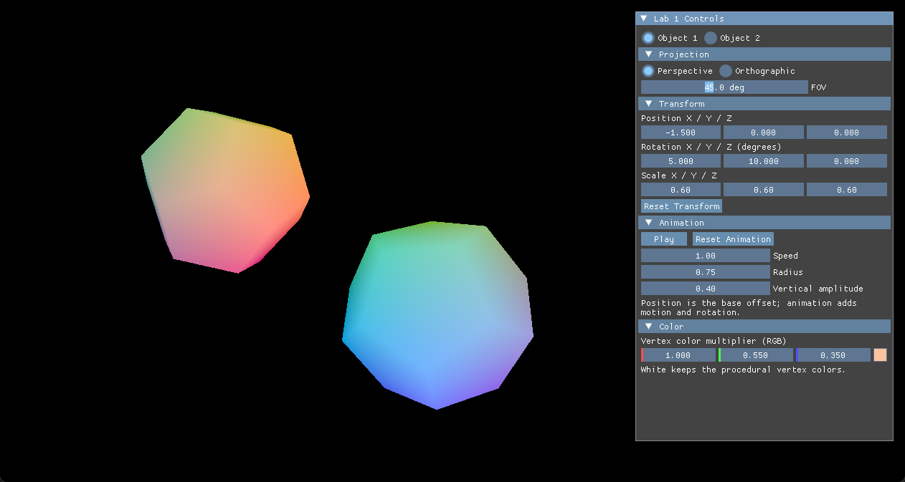
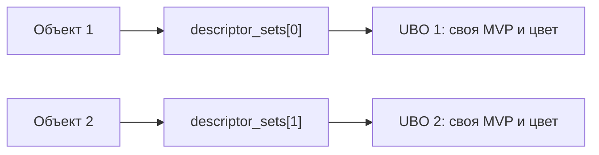

> Ветка **lab2-v10** содержит лабораторную №2 «Камера и освещение»: [описание, сборка и защита](LAB2.md).
> Ниже сохранена историческая документация лабораторной №1.

# Лабораторная №1 — компьютерная графика на Vulkan

**Вариант 10 · Правильный додекаэдр · Базовая часть и дополнительные задания 1–6**


Приложение на C++20 и Vulkan показывает два правильных додекаэдра с процедурными
цветами вершин. Через ImGui можно переключать проекцию, перемещать, поворачивать,
масштабировать и анимировать каждый объект, а также менять его цветовой множитель.

Оба объекта используют **одну геометрию и один графический конвейер**, но имеют
**разные наборы дескрипторов и собственные буферы параметров объектов (UBO)**.



*Начальная сцена: два объекта в разных позициях, с разными размерами, поворотами и цветами.*

## Содержание

- [Что реализовано](#что-реализовано)
- [Требования и зависимости](#требования-и-зависимости)
- [Сборка и запуск на Windows](#сборка-и-запуск-на-windows)
- [Управление в интерфейсе](#управление-в-интерфейсе)
- [Как устроена отрисовка](#как-устроена-отрисовка)
- [Структура проекта](#структура-проекта)
- [Проверки и валидация](#проверки-и-валидация)
- [Частые вопросы](#частые-вопросы)
- [Основа проекта и лицензия](#основа-проекта-и-лицензия)

## Что реализовано

| Часть работы | Реализация |
|---|---|
| Базовая часть, вариант 10 | Правильный додекаэдр: 20 уникальных вершин, 12 пятиугольных граней |
| Дополнительное задание №1 | Перспективная и ортографическая проекции с настройкой параметров |
| Дополнительное задание №2 | Перемещение, поворот и масштабирование по трём осям |
| Дополнительное задание №3 | Пространственная анимация с вращением, паузой и регулировкой скорости |
| Дополнительное задание №4 | Изменение RGB-множителя объекта через `ColorEdit3` и UBO |
| Дополнительное задание №5 | Вычисление цвета каждой вершины из её координат |
| Дополнительное задание №6 | Два объекта, два `VkDescriptorSet` и два отдельных UBO при общей геометрии и одном конвейере |

В приложении также работают изменение размера окна, сворачивание и восстановление,
проверка глубины и освобождение ресурсов при завершении.

## Требования и зависимости

Для сборки на Windows нужны:

| Инструмент | Назначение |
|---|---|
| Git | Скачивание проекта и зависимостей |
| CMake 3.20 или новее | Настройка и сборка проекта |
| MinGW с поддержкой C++20 | Компиляция C++ |
| `mingw32-make` | Сборка при использовании конфигурации `mingw-debug` |
| Vulkan SDK с `glslc` | Заголовки, библиотеки, слои валидации и компиляция шейдеров |
| Драйвер видеокарты с поддержкой Vulkan | Запуск приложения |

Проверенная конфигурация: **Windows, GCC 14.1.0, GNU Make 4.4.1, CMake 4.1.1,
Vulkan SDK 1.4.363.0, Intel UHD Graphics**.

Библиотеки загружаются автоматически через CMake `FetchContent`; подмодулей Git нет:

| Библиотека | Для чего используется |
|---|---|
| GLFW | Окно и обработка событий |
| vk-bootstrap | Создание основных объектов Vulkan |
| Vulkan Memory Allocator (VMA) | Выделение и освобождение памяти буферов |
| Dear ImGui | Интерфейс управления |
| GLM | Векторы, матрицы и преобразования |

## Сборка и запуск на Windows

### Подготовка терминала

Переменная `VULKAN_SDK` должна указывать на каталог установленного SDK.
В `PATH` должны быть доступны `cmake`, `g++`, `mingw32-make` и `glslc`.
Для сборки с MinGW выберите путь к проекту **без кириллицы**, например `C:\projects`.

Проверить инструменты в терминале можно командами:

```text
git --version
cmake --version
g++ --version
mingw32-make --version
glslc --version
```

Название `MINGW64` в приглашении Git Bash само по себе не означает, что компилятор
и Make установлены: приведённые команды должны находить соответствующие программы.

### Первый запуск из PowerShell

Если `VULKAN_SDK` ещё не задан, сначала укажите **свой** путь к SDK. Например:

```powershell
$env:VULKAN_SDK = 'C:\VulkanSDK\1.4.363.0'
$env:Path = "$env:VULKAN_SDK\Bin;$env:Path"
```

В этот пример не входят пути к MinGW и Make: они также должны присутствовать в `PATH`.
Затем откройте терминал в выбранной папке и выполните:

```powershell
git clone https://github.com/mariakotikw/vulkan-lab1-v10.git
cd vulkan-lab1-v10
$env:VK_LAYER_PATH = Join-Path $env:VULKAN_SDK 'Bin'
cmake --preset mingw-debug
cmake --build build-debug --parallel 4
.\build-debug\vulkan-starter-app.exe
```

При первой настройке CMake потребуется интернет для загрузки зависимостей.
Файлы `.spv` создаются автоматически из GLSL во время сборки.

### Первый запуск из Git Bash в VS Code

При уже настроенных `PATH` и `VULKAN_SDK` команды выглядят так:

```bash
git clone https://github.com/mariakotikw/vulkan-lab1-v10.git
cd vulkan-lab1-v10
export VK_LAYER_PATH="$(cygpath -w "$VULKAN_SDK/Bin")"
cmake --preset mingw-debug
cmake --build build-debug --parallel 4
./build-debug/vulkan-starter-app.exe
```

### Повторный запуск и пересборка

**Если код не менялся, собирать проект каждый раз не нужно.** Из корня проекта
достаточно запустить уже готовый исполняемый файл:

| Терминал | Команда запуска |
|---|---|
| PowerShell | `.\build-debug\vulkan-starter-app.exe` |
| Git Bash | `./build-debug/vulkan-starter-app.exe` |

После изменения C++ или шейдеров выполните:

```text
cmake --build build-debug --parallel 4
```

После добавления исходников или изменения настроек CMake сначала повторите
`cmake --preset mingw-debug`, затем сборку.

Запускайте приложение **из корня проекта**, где находятся `README.md` и `shaders/`:
шейдеры загружаются по относительным путям.

### Локальные скрипты существующего рабочего окружения

В окружении, где лабораторная уже настроена, можно использовать прежние команды
из PowerShell:

```powershell
& .\.tools\build.ps1
& .\.tools\start.ps1
```

Или из Git Bash:

```bash
powershell.exe -NoProfile -ExecutionPolicy Bypass -File ./.tools/build.ps1
powershell.exe -NoProfile -ExecutionPolicy Bypass -File ./.tools/start.ps1
```

Эти скрипты подготавливают локальные пути и переменные среды. Каталог `.tools/`
не входит в публичный репозиторий; для свежего клона используются команды выше.

## Управление в интерфейсе

Все элементы находятся в окне **`Lab 1 Controls`** справа от сцены.
Кнопки **Object 1 / Object 2** выбирают объект для редактирования.
Настройки проекции общие для сцены; преобразования, анимация и цвет задаются отдельно
для каждого объекта.

Числовые поля можно менять перетаскиванием мыши. Для точного ввода используйте
`Ctrl` + щелчок по значению. Заголовки разделов позволяют сворачивать их содержимое.

| Раздел | Элемент | Действие |
|---|---|---|
| Выбор объекта | Object 1 / Object 2 | Выбор объекта, чьи параметры показаны в меню |
| Projection | Perspective | Перспектива: одинаковый объект вдали выглядит меньше |
| Projection | Orthographic | Ортографическая проекция: размер объекта не зависит от расстояния до камеры |
| Projection | FOV | Полный угол обзора по вертикали, от 15° до 90°. Больший угол показывает больше сцены |
| Projection | Half height | Половина высоты видимой области в ортографической проекции; большее значение уменьшает объекты на экране |
| Transform | Position X / Y / Z | Перемещение по мировым осям |
| Transform | Rotation X / Y / Z | Поворот в градусах вокруг каждой оси |
| Transform | Scale X / Y / Z | Масштаб по каждой оси; одинаковые значения сохраняют пропорции |
| Transform | Reset Transform | Восстановление начальных положения, поворота и масштаба выбранного объекта |
| Animation | Play / Pause | Запуск или приостановка движения и вращения |
| Animation | Reset Animation | Обнуление фазы анимации; состояние Play/Pause и параметры сохраняются |
| Animation | Speed | Скорость движения и вращения |
| Animation | Radius | Радиус движения в плоскости XZ |
| Animation | Vertical amplitude | Размах движения вверх и вниз по Y |
| Color | RGB | Цветовой множитель для процедурных цветов вершин |

При `FOV = 90°` камера охватывает по 45° вверх и вниз от направления взгляда.
FOV меняет угол обзора, а положение камеры остаётся `(3.5, 3.5, 3.5)`; камера смотрит
на начало координат.

Выбор другого объекта сохраняет работу анимации предыдущего. Можно включить
анимацию обоих объектов. При `Radius = 0` сохраняются вращение и движение по Y,
если вертикальная амплитуда больше нуля.

Белый RGB-множитель `(1, 1, 1)` показывает исходные процедурные цвета.
Чтобы вернуть объект в исходное положение после анимации, нажмите
**Pause → Reset Animation → Reset Transform**. Цвет и параметры анимации сохраняются.

### Что попробовать

1. Переключите Perspective и Orthographic и сравните сцену.
2. В Perspective измените FOV с 45° на 60°.
3. Для Object 1 измените положение и поворот; затем нажмите Reset Transform.
4. Включите Play и измените Speed, Radius и Vertical amplitude.
5. Выберите Object 2 и измените его цвет: первый объект продолжит анимацию.
6. Измените размер окна, сверните и восстановите его.

### Начальные параметры объектов

| Объект | Положение | Поворот, градусы | Масштаб | RGB-множитель |
|---|---|---|---|---|
| Object 1 | `(-1.5, 0, 0)` | `(5, 10, 0)` | `(0.6, 0.6, 0.6)` | `(1.0, 0.55, 0.35)` |
| Object 2 | `(1.5, 0, 0)` | `(15, 35, 5)` | `(0.5, 0.5, 0.5)` | `(0.35, 0.65, 1.0)` |

## Как устроена отрисовка

### Геометрия и цвета

Правильный додекаэдр имеет **20 вершин и 12 пятиугольных граней**.
Координаты заданы через золотое сечение `phi = (1 + sqrt(5)) / 2`.
Каждый пятиугольник разбит на три треугольника: всего **36 треугольников и 108 индексов**.

Цвет вершины вычисляется из её локальной позиции:

```text
цвет = (позиция / phi + 1) * 0.5
```

Вершинный шейдер умножает этот цвет на RGB-множитель объекта. Между вершинами цвет
интерполируется, а фрагментный шейдер записывает его в изображение.

### Матрицы и данные объектов

Для каждого объекта вычисляется собственная матрица модели; камера и проекция общие:

```text
MVP[i] = Projection × View × Model[i]
Model[i] = T × Rx × Ry × Rz × S
```

`T` включает ручное положение и смещение анимации, `Rx/Ry/Rz` — ручной поворот
и вращение анимации, `S` — масштаб. Фаза анимации обновляется по прошедшему времени,
поэтому скорость не зависит от числа кадров в секунду.

Каждый UBO содержит `mat4 mvp` и `vec4 user_color`. Структура `TransformUniform`
имеет размер **80 байт** и выравнивание **16 байт**; соответствие `std140` проверяется
на этапе компиляции через `static_assert`.

### Отдельные дескрипторы при общей геометрии



| Ресурс сцены додекаэдров | Количество |
|---|---:|
| Объекты | 2 |
| Наборы дескрипторов `VkDescriptorSet` | 2 |
| Буферы параметров объектов (UBO) | 2 |
| Вершинные буферы | 1 |
| Индексные буферы | 1 |
| Графические конвейеры | 1 |
| Макеты наборов дескрипторов | 1 |
| Пулы дескрипторов | 1 |
| Индексированные вызовы рисования за кадр | 2 |

Это ресурсы сцены; ImGui отдельно создаёт ресурсы для интерфейса.
Пул рассчитан на два набора и два дескриптора `VK_DESCRIPTOR_TYPE_UNIFORM_BUFFER`.

В `application::render()` конвейер и буферы геометрии привязываются один раз,
а перед каждым объектом вызывается **отдельный `vkCmdBindDescriptorSets()`**:

```cpp
for (size_t i = 0; i < descriptor_sets.size(); ++i) {
    vkCmdBindDescriptorSets(fd.command_buffer, VK_PIPELINE_BIND_POINT_GRAPHICS,
                            pipeline_layout, 0, 1, &descriptor_sets[i], 0, nullptr);
    vkCmdDrawIndexed(fd.command_buffer, index_count, 1, 0, 0, 0);
}
```

### Жизненный цикл кадра и ресурсов

1. `initialize()` создаёт геометрию, буферы, дескрипторы и конвейер.
2. `prepare()` дожидается завершения предыдущего кадра и получает изображение swapchain.
3. `update()` обрабатывает интерфейс, обновляет анимацию и записывает данные в оба UBO.
4. `render()` сбрасывает и записывает буфер команд: начинает render pass, рисует два
   объекта, завершает render pass и запись команд.
5. `submitAndPresent()` отправляет команды сцены и ImGui на выполнение и показывает кадр.
6. `shutdown()` дожидается завершения работы видеокарты и освобождает ресурсы.

Смена размера окна обновляет swapchain и область рисования. Пропорции проекции
вычисляются по области сцены слева от меню, поэтому объекты не растягиваются.
Запись UBO выполняется после ожидания fence; видимость записей обеспечивает
`vmaFlushAllocation`. Наборы дескрипторов освобождаются при уничтожении их пула,
буферы — вместе с выделенной VMA памятью.

В starter также исправлены запись ранее пустого буфера команд, необходимый проход
отрисовки перед ImGui, зависимости render pass и обработка сворачивания окна.
Слои валидации сохранены включёнными.

## Структура проекта

| Файл или каталог | Назначение |
|---|---|
| [source/application.cpp](source/application.cpp) | Создание и удаление ресурсов лабораторной, ImGui, обновление UBO и запись команд рисования |
| [source/application.hpp](source/application.hpp) | Исходный интерфейс: `initialize`, `shutdown`, `update`, `render` |
| [source/application_state.cpp](source/application_state.cpp) и [application_state.hpp](source/application_state.hpp) | Состояние сцены и объектов, проекции, преобразования и анимация |
| [source/dodecahedron.cpp](source/dodecahedron.cpp) и [dodecahedron.hpp](source/dodecahedron.hpp) | Геометрия и процедурные цвета вершин |
| [source/graphics.cpp](source/graphics.cpp) и [graphics.hpp](source/graphics.hpp) | Создание, заполнение и освобождение буферов |
| [source/graphics_internal.cpp](source/graphics_internal.cpp) и [graphics_internal.hpp](source/graphics_internal.hpp) | Инфраструктура Vulkan: контекст, swapchain, синхронизация и отрисовка ImGui |
| [source/main.cpp](source/main.cpp) | Окно, события, главный цикл и завершение приложения |
| [shaders/](shaders/) | Вершинный и фрагментный шейдеры GLSL |
| [tests/](tests/) | Проверки геометрии и состояния, наблюдение за отрисовкой и проверки интерфейса |
| [CMakeLists.txt](CMakeLists.txt) и [CMakePresets.json](CMakePresets.json) | Зависимости, сборка C++ и компиляция шейдеров |
| [docs/screenshots/](docs/screenshots/) | Снимок работающего приложения |
| [LAB1.md](LAB1.md) | Дополнительные технические сведения и история этапов лабораторной |
| [LICENSE](LICENSE) и [NOTICE](NOTICE) | Лицензия и сведения об авторстве starter |

Каталоги `build-*`, скомпилированные шейдеры `.spv`, `imgui.ini` и локальная `.tools/`
исключены из Git. Зависимости и результаты сборки создаются на компьютере при сборке.

## Проверки и валидация

Результаты выполненных проверок на указанной выше конфигурации:

| Проверка | Результат |
|---|---|
| Геометрия додекаэдра и состояние приложения через CTest | **2 из 2 успешно** |
| Проверки настоящих действий в ImGui | **62 из 62 успешно** |
| Сравнение снимков: два объекта, независимые цвет и масштаб, обе проекции, resize | **Успешно** |
| Ошибки Validation Layers | **0 ERROR** |
| Предупреждения Validation Layers | **0 WARNING** |
| Код завершения приложения | **0** |

Обычный запуск проверялся с включёнными Khronos Core и Synchronization Validation:
несколько секунд отрисовки, изменение размера до 1000×680 и обратно до 1280×720,
сворачивание, восстановление и штатное закрытие окна. Ошибок при завершении не было.

После сборки проверки геометрии и состояния запускаются из корня проекта:

```text
ctest --test-dir build-debug --output-on-failure
```

- `dodecahedron-geometry` проверяет вершины, рёбра, правильность пятиугольных граней,
  индексы, направление треугольников и процедурные цвета.
- `application-controls` проверяет матрицы проекций и преобразований, сброс параметров,
  поведение анимации и независимость данных двух объектов.

Расширенная проверка интерфейса использует `tests/verify_controls.ps1` и тестовый
наблюдатель, который включается через `LAB1_ENABLE_UI_TEST_HOOKS=ON`. Она проверяет
разные реальные дескрипторы и UBO, записанные данные, два вызова рисования и общий
конвейер с общими буферами геометрии. Этот набор требует настроенной локальной `.tools/`
и рабочего стола Windows; для проверки изображений нужны NumPy и Pillow.
В обычной сборке наблюдатель выключен: `LAB1_ENABLE_UI_TEST_HOOKS=OFF`.

## Частые вопросы

**Нужно ли пересобирать перед каждым запуском?**

Нет. Пересборка нужна после изменения C++ или шейдеров. Уже собранное приложение
запускается напрямую через `build-debug/vulkan-starter-app.exe`.

**Почему приложение не находит шейдер?**

Проверьте рабочую папку: запускать нужно из корня репозитория. Файлы
`shaders/dodecahedron.vert.spv` и `shaders/dodecahedron.frag.spv` появляются после сборки.

**Почему CMake не находит `glslc`, компилятор или Make?**

Нужная программа должна быть установлена и доступна через `PATH` в текущем терминале.
После установки или изменения переменных среды откройте новый терминал.

**Почему MinGW не собирает проект в папке с русским названием?**

В проверенном окружении MinGW Make некорректно обрабатывал кириллицу в пути.
Для нового клона используйте путь без кириллицы. Локальные скрипты существующего
окружения решают это через junction с ASCII-путём.

**Почему выбранный объект всё ещё вращается после Reset Transform?**

Эта кнопка сбрасывает ручные преобразования. Чтобы сбросить также влияние анимации,
нажмите Pause, затем Reset Animation и Reset Transform.

**Где исходная инструкция преподавателя?**

Она доступна в [исходном starter](https://github.com/vladeemerr/vulkan-starter-app).
В этом README сохранены инструкции для первой лабораторной; описание второй находится в [LAB2.md](LAB2.md).

## Основа проекта и лицензия

Проект основан на [vulkan-starter-app](https://github.com/vladeemerr/vulkan-starter-app)
преподавателя. Сохранены структура starter, публичный интерфейс приложения,
использование Vulkan и включённая валидация.

Ветка лабораторной №1 — **`lab1-v10`**. В её истории Git сохранены этапы:
исправленный starter (`19a2084`), базовая лабораторная (`36cbd01`) и стабильная версия
с заданиями 1–5 (`f830316`). Итоговая версия первой лабораторной включает дополнительное задание №6.

Лицензия — **Apache-2.0**. Исходные файлы [LICENSE](LICENSE) и [NOTICE](NOTICE),
содержащие условия лицензии и сведения об авторстве, сохранены.
