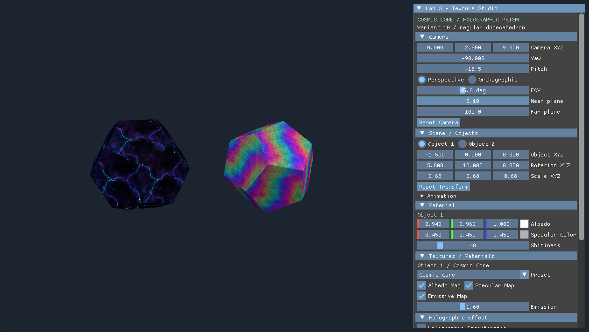
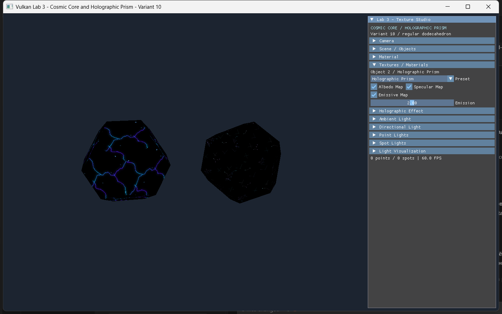

# Проверки лабораторной №3

Проверено 3–4 ноября 2026 года на Windows x64, MinGW/UCRT64 GCC 14.1.0,
Vulkan SDK 1.4.363.0, Intel(R) UHD Graphics. База — `lab2-v10`, коммит
`69619607e3fbd0ddaf0fc03bf055ac88e232a324`. Рабочая ветка — `lab3-v10`.

## Фактически выполненные проверки

| Проверка | Результат | Подтверждение |
|---|---|---|
| CMake и C++20 Debug | Сборка выполнена | `scripts/build.ps1` |
| GLSL → SPIR-V | Все четыре шейдера скомпилированы glslc | CMake target `shaders` |
| SPIR-V Validator | Четыре модуля прошли spirv-val | `scripts/build.ps1` |
| Исходная геометрия | PASS | `dodecahedron-geometry` в [ctest.log](ctest.log) |
| Прежние преобразования, камера и пространственная анимация | PASS | `application-controls` |
| Нормали, normal matrix, материалы, свет и gizmos | PASS | `camera-lighting-gizmos` |
| UV, Dynamic UBO и Push Constants | PASS | `uv-dynamic-ubo-push-constants` |
| Декодирование 10 PNG с диска, отказ на ошибочных файлах | PASS | `png-file-decoding` |
| Качество PNG: размеры, CRC, контраст, согласованность и локальность Emissive | PASS | `texture-asset-quality` |
| Настоящий SPIR-V: offsets, strides, sampler bindings, Push Constants и несколько samples | PASS | `shader-memory-layout` |
| CTest суммарно | **7/7 PASS** | [ctest.log](ctest.log) |
| Управление новыми настройками через ImGui | **18 проверок PASS** | [textures-ui/result.json](textures-ui/result.json), [checks.json](textures-ui/checks.json) |
| Проверки реальных изображений | **17 проверок PASS** | [textures-ui/image-checks.json](textures-ui/image-checks.json) |
| Обычный запуск, resize, minimize/restore, закрытие | Exit 0, Validation errors 0, warnings 0 | [vulkan-results.json](vulkan-results.json), `normal-stdout.log`, `normal-stderr.log` |
| Smoke-сценарий, 600 кадров | Exit 0, Validation errors 0, warnings 0 | [vulkan-results.json](vulkan-results.json), `smoke-stdout.log`, `smoke-stderr.log` |
| Воспроизводимость процедурных материалов | Повторная генерация дала одинаковые SHA-256 для **10/10 PNG** | `scripts/generate_textures.py`; проверено в отдельном локальном каталоге |

Все CTest выполнялись на этой версии исходников. Для новых графических проверок
собирался вариант с `-UiHooks`. При завершении также собран обычный вариант
без UI-инструментализации и выполнены обычный и smoke-прогоны.
Synchronization Validation включена через `tests/validation/vk_layer_settings.txt`.
Счётчики ошибок и предупреждений выводятся после освобождения Vulkan-ресурсов.
Сообщение о suboptimal swapchain при изменении окна не является ошибкой Validation Layer.

## Что подтверждают изображения

- При остановленной геометрической анимации Holographic Interference изменяет
  правую модель: в сохранённой паре кадров изменилось **33 726 пикселей**.
  У левой модели не изменилось ни одного пикселя.
- При отключении эффекта обе сцены в последовательных кадрах совпадают.
- Без Ambient, Directional, Point и Spot Lights Cosmic Core сохраняет
  видимые энергетические прожилки — 2748 ярких цветных пикселей.
- При выборе Prism Grid отсутствующая Emissive Map даёт полностью чёрную
  поверхность без внешнего света. Чёрный fallback не имитирует свечение.
- В демонстрации слабой Emissive Map Holographic Prism через ImGui выставлено
  `Emission = 2.0`; видимы неоновые линии. Стартовое значение приложения остаётся
  0.55, а у Cosmic Core — 1.6. После отключения карты правая поверхность темнеет,
  изображение левой модели сохраняется.
- Specular Map добавляет блики: изменяются 11 836 пикселей правой модели,
  изменения только в сторону увеличения яркости. Не затронутые бликом области
  с диффузной составляющей сохраняются.
- Отключение Albedo Map меняет рисунок поверхности, не меняя соседний объект.
- В начальной сцене нет пересвеченных белых участков, занимающих целые грани.





## Подтверждение организации памяти

Журналы показывают: Vertex Buffer — 2640 байт, Index Buffer — 432 байта,
`memoryFlags=1`, `mapped=no`. Это `VK_MEMORY_PROPERTY_DEVICE_LOCAL_BIT`.
Изображения также выделены с этим свойством. На интегрированном GPU это
классификация памяти Vulkan; наличие отдельной дискретной VRAM не предполагается.

`ObjectUniform` занимает 160 байт. На проверенном устройстве
`minUniformBufferOffsetAlignment = 64`, выровненный stride — 192, общий буфер —
384 байта. Смещения объектов — 0 и 192, descriptor range — 160 байт.
Четыре material sets ссылаются на один буфер. UI-тест проверяет также случай,
когда оба объекта используют один и тот же material set с разными offsets.

Push Constants занимают 48 байт. Проверены отдельные флаги эффекта на каждом
draw, передача времени и всех четырёх параметров эффекта. Shader memory layout
проверен по скомпилированному SPIR-V.

## Воспроизведение

В PowerShell из корня проекта, при установленном SDK и зависимостях:

```powershell
.\scripts\build.ps1 -UiHooks
.\tests\verify_texture_controls.ps1
python .\tests\verify_texture_rendering.py
.\scripts\build.ps1
.\scripts\verify-vulkan.ps1
```

При необходимости укажите `-DependencyRoot <каталог _deps>`, как описано в
[LAB3.md](../../../LAB3.md). Для анализа изображений нужны NumPy и Pillow;
декодер PNG приложения и CTest проверки PNG не требуют этих Python-библиотек.

Проверки интерфейса первых лабораторных сохранены и адаптированы к Dynamic UBO,
но полные старые desktop-сценарии в этом прогоне повторно не выполнялись.
Основные регрессионные математические тесты входят в выполненные 7 CTest.

## Ограничения

Release, MSVC, другие ОС и GPU отдельно не проверялись. Не моделировались потеря
устройства и исчерпание памяти. Используется один mip-уровень с линейной
фильтрацией; при сильном удалении возможен алиасинг тонкого рисунка.
Bloom/HDR, прозрачность и физическая иридесценция не реализованы и не требуются
условием. Незавершённых обязательных функций или дополнительных заданий нет.
