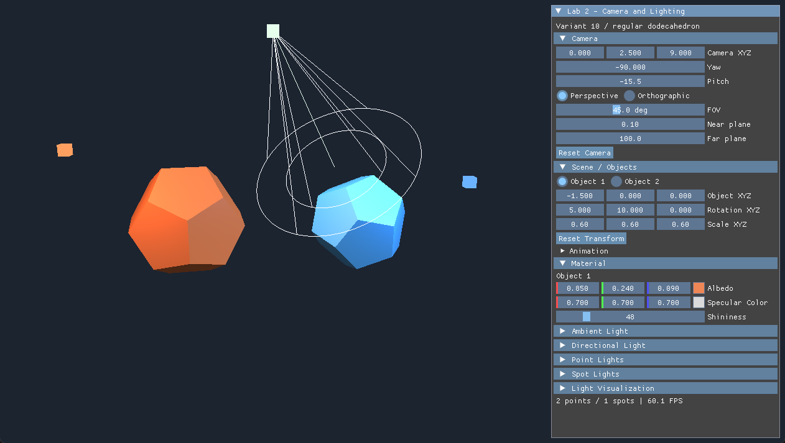

# Результаты проверки лабораторной №2

Дата проверки: 22 октября 2026 года. Ветка: `lab2-v10`, база `lab1-v10`
(`7f246743365b47bee1be3f2e33a47cde2fce50f2`).

Окружение: Windows x64, GCC/MinGW UCRT64 14.1.0, Vulkan SDK 1.4.363.0,
реальное устройство **Intel(R) UHD Graphics**. Использованы закреплённые
зависимости исходного проекта. Графическая часть действительно запускалась.

| Проверка | Результат | Подтверждение |
|---|---|---|
| CMake, C++20 Debug | Успешно; финальный исполняемый файл собран без UI test hooks | `build-debug-v/vulkan-starter-app.exe`, локальный build output |
| GLSL → SPIR-V | Все 4 shader успешно скомпилированы glslc | CMake target `shaders` |
| SPIR-V Validator | Все 4 бинарника прошли `spirv-val --target-env vulkan1.0` | `scripts/build.ps1` завершился успешно |
| Геометрия первой работы | PASS | [ctest.log](ctest.log), `dodecahedron-geometry` |
| Преобразования и анимация первой работы | PASS | [ctest.log](ctest.log), `application-controls` |
| Камера, нормали, normal matrix, материалы, свет, gizmos | PASS | [ctest.log](ctest.log), `camera-lighting-gizmos` |
| Смещения, strides, Descriptor Sets в настоящем SPIR-V | PASS | [ctest.log](ctest.log), `shader-memory-layout` |
| CTest суммарно | **4/4 PASS** | [ctest.log](ctest.log) |
| Прежние элементы управления через реальный ImGui | **62 проверки PASS** | [ui/result.json](ui/result.json), [ui/checks.json](ui/checks.json) |
| Новые элементы Camera, Material, Point/Spot, Show Light Gizmos | **19 проверок PASS** | [lighting-ui/result.json](lighting-ui/result.json), [lighting-ui/checks.json](lighting-ui/checks.json) |
| Изображения: масштаб, цвета, независимость моделей, обе проекции и resize | Все проверки PASS | [ui/image-checks.json](ui/image-checks.json) |
| Реальный вклад света в изображение | Включение Directional изменило **39 077 пикселей** сцены относительно всех выключенных источников | [lighting-ui/image-checks.json](lighting-ui/image-checks.json), `all-lights-off.png`, `directional-only.png` |
| Обычный Vulkan-прогон: resize 1000×680 → 1280×760, minimize/restore, закрытие | Exit 0, **Validation errors 0, warnings 0** | [vulkan-results.json](vulkan-results.json), [normal-stdout.log](normal-stdout.log), [normal-stderr.log](normal-stderr.log) |
| 600 кадров с динамическими изменениями сцены | Exit 0, **Validation errors 0, warnings 0** | [vulkan-results.json](vulkan-results.json), [smoke-stdout.log](smoke-stdout.log), [smoke-stderr.log](smoke-stderr.log) |

Финальные обычный и smoke-прогоны выполнены на сборке **без UI test hooks**.
Проверки ввода в ImGui перед этим выполнены на сборке с hooks. В каждом
графическом прогоне проверялась загрузка `VkLayer_khronos_validation.dll`.
Synchronization Validation включена настройкой
`khronos_validation.validate_sync = true` в `tests/validation/vk_layer_settings.txt`.
Счётчики ошибок/предупреждений печатаются после освобождения ресурсов Vulkan,
поэтому охватывают также завершение программы. Сообщение `Swapchain is suboptimal`
в stderr относится к штатному состоянию поверхности при изменении окна и
не является сообщением Validation Layer.

Smoke-сценарий проходит фазы 0…9: стартовая сцена, удаление всего динамического
света, добавление 33 Point и 33 Spot, повторное удаление, добавление по одному,
равные углы и нулевое направление, перепутанные углы, перемещение камеры,
неравномерный масштаб и материал, gizmos off/on, Orthographic, сброс и анимация.
Отдельные CPU-тесты выполняют добавление и удаление 128 источников каждого типа.

UI-проверки подтверждают замену VkBuffer при росте SSBO, сохранение действительного
буфера при нулевом количестве источников, загрузку фактического количества в
Scene UBO и раздельные Scene/Object descriptor sets. В историческом
`ui/result.json` поле `descriptorSets: 2` учитывает два **Object** set, как и тест
первой работы. Дополнительный общий Scene set проверен новым тестом; всего sets 3.

Сравнение изображений проверяет точное совпадение пикселей другой модели
при изменении масштаба/материала выбранной. Изменение масштаба Object 1 с 0,6
до 0,36 уменьшило видимую площадь до 0,3686 исходной. Модели целиком помещаются
в кадр в обоих режимах проекции при проверенных размерах окна.



## Воспроизведение

Из корня проекта при установленном SDK и MinGW Make в PATH:

```powershell
.\scripts\build.ps1 -UiHooks
.\tests\verify_controls.ps1
.\tests\verify_lighting_controls.ps1
python .\tests\verify_images.py
.\scripts\build.ps1
.\scripts\verify-vulkan.ps1
```

Для уже имеющихся зависимостей добавьте `-DependencyRoot <путь к _deps>` к
командам сборки; точная команда для текущей машины находится в [LAB2.md](../../LAB2.md).
Скрипт сборки обходит кириллицу в пути временным псевдодиском V: и удаляет его
после выполнения. Полные промежуточные live JSON и snapshots оставлены локально
и исключены из Git; существенные результаты, журналы и изображения сохранены.

## Границы проверки

Незавершённых обязательных функций или дополнительных заданий не осталось.
Не проверялись Release, MSVC, Linux/macOS и другие GPU. Не моделировались
исчерпание видеопамяти, потеря устройства и изменение формата поверхности
при переносе между мониторами. Проверенные resize и minimize/restore работают
на указанном устройстве. Тесты не доказывают отсутствие ошибок во всех возможных
условиях. Текстурирование, тени, HDR и объёмное рассеяние не входят в эту реализацию.
